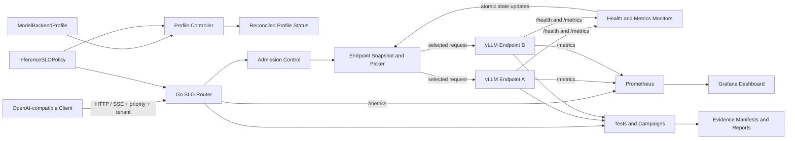
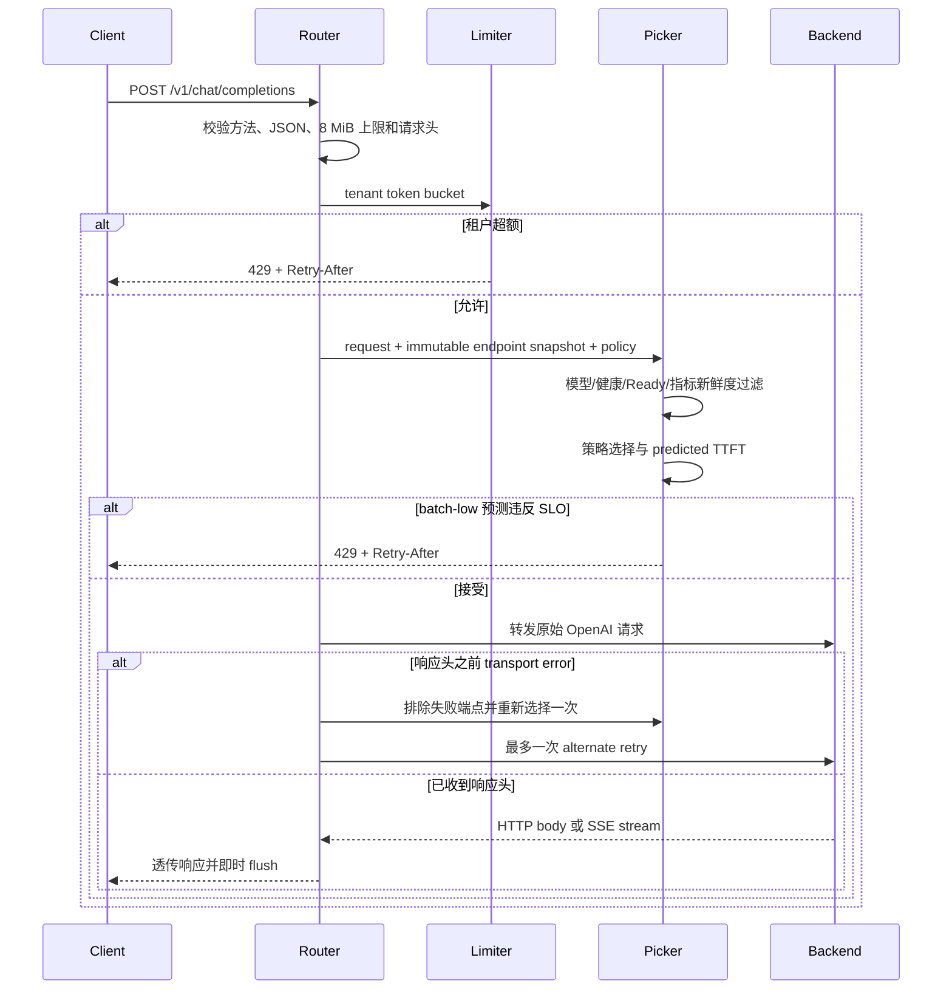

# LLM SLO Orchestrator 项目详细介绍

## 1. 项目概览

| 项目属性 | 内容 |
| --- | --- |
| 项目名称 | LLM SLO Orchestrator |
| 项目定位 | 面向自托管 vLLM 推理服务的 SLO 感知路由、准入控制、故障恢复与性能证据系统 |
| 主要语言 | Go、Python、YAML |
| 运行平台 | Windows 11 + WSL2 Ubuntu + Docker Desktop + NVIDIA GPU |
| 当前状态 | 核心功能完成，本机真实模型 L2 演示通过 |
| 目标岗位 | AI Infra、推理服务、云原生后端、Go 后端、性能工程、平台工程 |

LLM SLO Orchestrator 不是一个简单的模型 API 包装器。它关注的是大模型
推理服务进入多端点和多租户环境后出现的工程问题：不同请求长度导致的负载
不均衡、队列积压、首 Token 延迟波动、低优先级流量挤压在线请求、端点故障、
监控数据失效，以及流式响应开始后不能安全重试等。

项目提供一个 OpenAI-compatible Go 路由器，并围绕它构建完整的本地工程闭环：

- 使用 SLO、队列、并发请求、KV Cache 和前缀亲和信息进行端点选择；
- 使用请求优先级和每租户 token bucket 进行准入控制；
- 主动探测后端健康状态，并根据连续成功/失败阈值完成摘除和恢复；
- 异步采集 vLLM 指标，拒绝使用过期指标进行路由；
- 保持 HTTP 与 SSE 流式转发语义，只在响应开始前执行一次安全重试；
- 通过 Prometheus 和 Grafana 展示路由器与 vLLM 的运行状态；
- 通过固定镜像 digest、模型 revision、实验清单和 evidence manifest 保证可复现性；
- 通过单元测试、race test、fake backend、kind 和真实 GPU 形成分级证据。

## 2. 项目背景与问题定义

单个 vLLM 端点可以提供 OpenAI-compatible API，但在多端点环境中，仅依靠
round-robin 并不能稳定满足在线推理 SLO，原因包括：

1. 请求的 prompt 和 output 长度差异很大，同一时刻分配的请求数量相同，并不
   代表实际计算负载相同。
2. 每个端点的 running、waiting、KV Cache 使用率和近期 TTFT 不同，静态轮询
   无法感知这些状态。
3. 重复前缀可能产生缓存亲和收益，但过度亲和又可能形成热点。
4. 在线对话与离线 batch 请求的延迟目标不同，统一排队可能让 batch 流量破坏
   在线请求体验。
5. 后端进程、容器、网络或指标抓取都可能失败。健康状态和指标新鲜度必须分别
   处理。
6. SSE 响应一旦向客户端发送，就不能把同一请求自动重放到另一个端点，否则
   可能产生重复内容或重复副作用。
7. 仅展示一次成功请求不足以证明系统可靠。实验输入、代码提交、镜像、模型和
   原始结果必须形成可追溯证据。

本项目把以上问题拆解为数据面路由、准入控制、健康与遥测控制环、模型容量
profile、可观测性和证据治理六个部分。

## 3. 项目目标与非目标

### 3.1 核心目标

- 提供兼容 OpenAI `/v1/*` 请求的低开销 Go 路由器。
- 支持 HTTP 非流式响应和 SSE 流式响应，并即时 flush。
- 提供 round-robin、random、least-outstanding、least-queue 和
  slo-prefix-affinity 五种策略。
- 仅从模型匹配、健康、Ready 且指标新鲜的端点中选择目标。
- 对低优先级高风险请求和超额租户流量进行可解释拒绝。
- 在端点故障时维持幸存端点服务，并在恢复后重新加入路由集合。
- 采集有界标签的 Prometheus 指标，提供自动 provision 的 Grafana dashboard。
- 建立 L0-L4 证据等级，明确本机结果能够和不能支持的结论。
- 提供 `make verify`、`make demo` 和 `make demo-real` 一键验证入口。

### 3.2 当前非目标

- 不把本机单 GPU 结果描述为生产集群性能。
- 不在缺少双真实端点时宣称某个多端点策略具有性能优势。
- 不实现完整的用户认证、计费、配额管理或持久化租户控制面。
- 不实现跨地域、多集群或分布式状态一致性。
- Gateway API Inference Extension、自动扩缩容、分布式推理和 Ascend 适配属于
  后续增强，不阻塞当前核心版本。

## 4. 总体架构



### 4.1 组件职责

| 组件 | 职责 |
| --- | --- |
| `cmd/router` | 读取策略和后端列表，启动 HTTP 服务、健康探测与指标采集 |
| `internal/router` | 请求解析、准入、端点快照、转发、SSE flush、安全重试和指标暴露 |
| `internal/picker` | 实现五种纯函数式端点选择策略和新鲜度过滤 |
| `internal/admission` | 实现有界、隔离的每租户 token bucket |
| `internal/backend` | 并发健康检查、vLLM Prometheus 指标解析和 TTFT EWMA 更新 |
| `cmd/profile-controller` | 校验 policy/profile 绑定关系并生成确定性状态 |
| `cmd/fake-backend` | 提供确定性 HTTP、SSE、健康和最小 vLLM 指标测试后端 |
| Prometheus/Grafana | 采集和展示 router、vLLM 的关键运行指标 |
| Python campaigns | 执行容量、fake、kind、真实 GPU、故障和演示验证 |

## 5. 完整请求处理流程



### 5.1 请求元数据

路由器支持以下请求头：

| 请求头 | 含义 | 默认值或限制 |
| --- | --- | --- |
| `X-Request-ID` | 请求标识，用于确定性随机和日志关联 | 缺失时由 router 生成 |
| `X-Request-Priority` | `online-high`、`online-normal`、`batch-low` | `online-normal` |
| `X-Tenant-ID` | 租户隔离和限流键 | `default`，最大 128 字符 |
| `X-Prefix-Key` | 前缀亲和输入 | 当前保留给亲和信息接入 |

路由器会返回以下可解释响应头：

| 响应头 | 含义 |
| --- | --- |
| `X-LLM-Endpoint` | 实际处理请求的端点 ID |
| `X-LLM-Request-ID` | 最终请求 ID |
| `X-LLM-Decision-Reason` | 路由选择原因 |
| `X-LLM-Policy-Generation` | 策略 generation |
| `X-LLM-Retry-Count` | 当前请求实际重试次数，正常为 0，安全重试后为 1 |

请求体通过 8 MiB 上限保护。POST 请求必须是合法 JSON；prompt token 数当前以
请求体字节数除以 4 进行轻量估算，这适合路由启发式，不等价于模型 tokenizer
的精确计数。

## 6. 路由策略

所有 picker 都是无网络 I/O 的纯选择逻辑。它们消费不可变
`EndpointSnapshot`，便于确定性测试和并发安全。

### 6.1 统一候选端点过滤

端点必须同时满足以下条件才会进入 picker：

1. `endpoint.Model == policy.Model`；
2. `Healthy == true`；
3. `Ready == true`；
4. `MetricAge >= 0`；
5. `MetricAge <= policy.MetricFreshness`。

没有合格端点时返回 HTTP 503，而不是向未知状态的后端盲目转发。

### 6.2 Round Robin

根据 endpoint snapshot generation 轮转，端点先按 ID 排序，因此行为稳定且
可复现。它是最基础的对照策略，不感知请求长度或运行时负载。

### 6.3 Deterministic Random

对 `RequestID` 使用 FNV-1a 哈希后选择端点。相同请求 ID 会得到相同选择，既
保留随机分布特征，也避免测试结果不可复现。

### 6.4 Least Outstanding

选择 router 本地观测到的 outstanding 请求数最少的端点。它能够反映尚未完成
的请求数量，适合验证异步混合长度请求是否比 round-robin 更均衡。

### 6.5 Least Queue

选择 vLLM `num_requests_waiting` 最小的端点。它更直接地关注推理引擎排队状态，
但依赖新鲜、可信的后端 metrics。

### 6.6 SLO Prefix Affinity

SLO-aware 策略计算四类归一化风险，并使用 policy 权重求和：

```text
score = queue * Wqueue
      + ttftRisk * WttftRisk
      + prefixMiss * Wprefix
      + utilization * Wutilization
```

- `queue`：`(running + waiting) / 16`，裁剪到 `[0, 1]`；
- `ttftRisk`：预测 TTFT 与目标 TTFT p95 的比值，裁剪到 `[0, 1]`；
- `prefixMiss`：`1 - PrefixAffinity`；
- `utilization`：KV Cache 使用率，裁剪到 `[0, 1]`。

当前示例权重为 queue 35%、TTFT risk 35%、prefix 20%、utilization 10%。同分时
按 endpoint ID 确定性选择。

预测 TTFT 使用近期 EWMA、outstanding/waiting 惩罚和 prompt 长度惩罚组合：

```text
predictedTTFT = ttftEWMA
              + (outstanding + waiting) * 10 ms
              + floor(promptTokens / 128) * 1 ms
```

当前 prefix key 已完成请求解析，picker 也支持 `PrefixAffinity` 特征，但真实
运行时的 prefix-cache 命中率适配器尚未接入。因此本机只能验证 H3 机制，不能
宣称真实前缀性能收益。

## 7. 两层准入控制

### 7.1 每租户 Token Bucket

每个 `X-Tenant-ID` 拥有独立 token bucket。示例策略设置：

- burst：8；
- refill rate：2 requests/second；
- 最大 bucket 数：4096；
- 超限响应：HTTP 429 和 `Retry-After`。

达到 4096 个租户状态时，limiter 会先删除超过 idle TTL 的 bucket；仍无法释放
空间时拒绝新租户请求，从而避免攻击者利用无限 tenant ID 导致内存无界增长。
租户 ID 不进入 Prometheus label，避免高基数指标问题。

### 7.2 SLO 风险准入

当 `batch-low` 请求的 predicted TTFT 超过 `maxPredictedTTFTMs` 时，当前主策略
拒绝请求并返回 429。在线请求继续参与路由，目标是让低优先级 batch 在拥塞时
主动让位。

准入结果记录为：

```text
router_admission_total{priority,reason}
```

`reason` 使用受控枚举，例如 `tenant-rate-limit` 和
`predicted-slo-violation`，不会把租户输入写入 label。

## 8. 后端健康与动态指标

### 8.1 主动健康检查

router 为每个端点独立启动健康检查 goroutine，默认参数为：

- interval：2 秒；
- timeout：1 秒；
- failure threshold：连续 2 次失败后摘除；
- success threshold：连续 1 次成功后恢复。

连续阈值避免一次瞬时错误造成路由集合抖动。健康状态变化使用 atomic 更新，
并输出 bounded endpoint 日志和指标。

### 8.2 vLLM 指标采集

router 默认每 2 秒异步抓取每个端点 `/metrics`，解析：

- `vllm:num_requests_running`；
- `vllm:num_requests_waiting`；
- `vllm:kv_cache_usage_perc`；
- `vllm:time_to_first_token_seconds_sum`；
- `vllm:time_to_first_token_seconds_count`。

TTFT 使用相邻 counter 的增量计算观测值，再以 0.2 新值、0.8 历史值更新 EWMA。
抓取失败不会刷新 `CollectedAt`，因此指标最终会超过 freshness TTL，端点随后被
picker 排除。这避免了“后端健康，但路由器继续使用旧队列数据”的问题。

健康状态和指标新鲜度是两个独立门禁：健康检查回答端点能否响应，指标门禁
回答端点状态是否足够新，二者不能互相替代。

## 9. HTTP、SSE 与安全重试边界

router 保留 OpenAI-compatible 路径和响应，删除 hop-by-hop headers，并将后端
响应头复制给客户端。对于 `text/event-stream`，每次写入后立即调用 flush，
避免把 SSE 缓冲成普通 HTTP 响应。

安全重试遵循严格边界：

- 最多重试一次；
- 仅在 transport error 且尚未收到后端响应头时重试；
- 重试时临时排除第一次失败的端点并重新执行 picker；
- 后端返回任何 HTTP 状态都不重试；
- 已经向客户端发送响应头或 SSE 数据后不重试；
- partial SSE 断开时，backup 端点收到的请求数必须为 0。

这项设计优先保证响应语义正确，而不是为了提高成功率进行不安全重放。

## 10. 策略与模型容量 Profile

`InferenceSLOPolicy` 描述目标与运行策略：

- 模型名称；
- TTFT p95、TPOT p95 和 availability 目标；
- 路由策略、四项权重和指标 freshness；
- predicted TTFT 准入阈值与 Retry-After；
- tenant burst 和 refill rate。

配置使用 `yaml.v3 KnownFields(true)` 严格解析，未知字段、额外 YAML document、
非法枚举、权重不等于 100 或非正数参数都会失败。

`ModelBackendProfile` 将容量结论绑定到：

- 固定模型及 revision；
- 固定 vLLM 镜像 digest；
- GPU 厂商、型号、数量和显存；
- tensor parallel、max model length 和 GPU memory utilization；
- prompt/output bucket、测试 QPS 和 TTFT；
- 原始 evidence manifest。

profile controller 校验 policy model 与 profile model 一致、metric freshness 不
超过三个采样周期、source evidence 文件存在，并对 policy/profile 内容生成
确定性 generation。`make verify` 会检查 reconciled JSON 是否发生漂移。

当前 profile 为：Qwen3-0.6B、RTX 5070 Ti 16 GiB、tensor parallel 1、最大
上下文 4096、GPU memory utilization 0.75。记录的 16 req/s 是 128 input / 64
output 场景下的最高已测试点，不是饱和上限或生产承诺。

## 11. 可观测性

router 暴露：

- `router_requests_total{endpoint,code}`；
- `router_admission_total{priority,reason}`；
- `router_backend_healthy{endpoint}`；
- `router_backend_health_check_age_seconds{endpoint}`；
- `router_outstanding_requests{endpoint}`。

Prometheus 同时抓取 router、vLLM 和自身。Grafana dashboard 使用固定 UID
`llm-slo-overview`，包含 9 个 panel：

1. Router Request Rate；
2. Router Failures and Rejections；
3. Backend Health；
4. Health Check Age；
5. Router Outstanding Requests；
6. vLLM TTFT p95；
7. vLLM TPOT p95；
8. vLLM KV Cache Usage；
9. vLLM Running and Waiting。

datasource 和 dashboard 均自动 provision。运行时校验会访问 Grafana API、
Prometheus ready API，并让 Prometheus 实际解析每一个 panel 的 PromQL，而不是
只检查 JSON 文件存在。

## 12. 本机部署环境与不可变依赖

| 层级 | 已验证配置 |
| --- | --- |
| 主机 | Windows 11 Pro 25H2, build 26200.8875 |
| WSL | WSL 2.7.10, kernel 6.18.33.2-2 |
| Linux | Ubuntu 24.04.4 LTS |
| GPU | NVIDIA GeForce RTX 5070 Ti, 16 GiB |
| 驱动 | 596.21，容器可见 CUDA capability 13.2 |
| Docker | Docker Desktop 4.82.0, Engine 29.6.1 |
| Kubernetes | kind 0.32.0, Kubernetes 1.36.1 |
| Go | 1.26.5 |
| Python | 3.12 |
| vLLM | 0.25.1，固定平台 digest |
| 模型 | Qwen/Qwen3-0.6B，固定 revision 与权重 SHA-256 |
| GuideLLM | 0.7.1，独立 lock 环境 |

关键不可变值：

```text
vLLM digest:
sha256:f0b9a0dc75a9fca3b6811e3279367b2d6a448055a000bfd13859587d74cef268

model revision:
c1899de289a04d12100db370d81485cdf75e47ca

model weights SHA-256:
f47f71177f32bcd101b7573ec9171e6a57f4f4d31148d38e382306f42996874b
```

由于 Docker Desktop/WSL 的 GPU 映射没有暴露 UVA，本机必须设置：

```text
VLLM_USE_V2_MODEL_RUNNER=0
```

CUDA 用户态库由容器提供，因此 Windows 主机不需要额外安装 CUDA Toolkit。
Ubuntu 使用 Docker Desktop WSL integration，不应再安装第二套独立 Docker
Engine，否则会造成 image、socket 和清理状态歧义。

## 13. 部署拓扑

### 13.1 Docker Compose

Compose 定义三个服务：

- `vllm`：固定 digest、GPU、8 GiB shared memory、离线模型挂载；
- `prometheus`：7 天 retention，监听 `127.0.0.1:9090`；
- `grafana`：匿名 Viewer，只监听 `127.0.0.1:3000`。

router 通常运行在 Ubuntu 主机进程中，监听 `127.0.0.1:8080`。Prometheus 容器
通过 `host.docker.internal:8080` 抓取 router。

### 13.2 Kubernetes kind

项目能够构建静态 router/fake-backend 镜像，创建临时 kind 集群，部署一套
router 加两个 fake backend，验证 health、HTTP、SSE、metrics 和清理。测试结束
后删除临时集群，不残留 Kubernetes 资源。

kind 路径证明 Kubernetes wiring 和控制面闭环，不能替代真实模型多端点性能
实验。

## 14. 研发阶段与交付内容

### W0：环境与契约冻结

- 检查 Windows、WSL2、Ubuntu、Docker Desktop 和 GPU 链路；
- 固定工具版本、镜像 digest、模型 revision 和权重 hash；
- 定义 `InferenceSLOPolicy`、目录结构和证据等级；
- 建立 `make verify` 基础入口。

### W1：真实单端点推理与容量校准

- 启动固定版本 vLLM 和 Qwen3-0.6B；
- 验证 `/health`、`/metrics`、非流式和 SSE 请求；
- 使用 GuideLLM 完成 smoke 和 0.5 到 16 req/s 容量曲线；
- 生成 L2 manifest、summary、raw metrics 和报告。

### W2：路由器与 Kubernetes

- 实现 Go OpenAI-compatible router；
- 实现五种 picker、HTTP/SSE、响应头和 Prometheus metrics；
- 使用两个 fake backend 验证 round-robin；
- 验证 router 到真实 vLLM 的 L2 路径；
- 使用 kind 验证 Kubernetes 部署和清理。

### W3：故障恢复与 Profile Reconciliation

- 实现阈值化主动健康探测；
- 完成端点 crash、幸存流量和恢复 re-entry campaign；
- 定义严格 `ModelBackendProfile`；
- 实现一次性、持续和 `--check` reconciliation；
- 自动从 evidence summary 生成状态报告并检查漂移。

### W4：准入、动态指标、可观测性与安全重试

- 完成 Grafana/Prometheus 自动 provisioning；
- 实现有界每租户 token bucket；
- 采集 vLLM running、waiting、KV 和 TTFT EWMA；
- stale metrics 超时后排除端点；
- 实现仅响应开始前最多一次 retry；
- 固定 H1-H4 实验门禁；
- 提供 `make demo`、`make demo-real` 和 8 分钟演示手册。

## 15. 实验设计与证据等级

### 15.1 证据等级

| 等级 | 环境 | 可支持结论 |
| --- | --- | --- |
| L0 | Go/Python、fake clock/backend | 算法、校验和并发正确性 |
| L1 | Compose 或 kind、fake backend | 部署、指标和控制面闭环 |
| L2 | 一个真实 GPU/NPU 端点 | 单端点流式、指标和容量行为 |
| L3 | 两个独立真实端点 | 多端点策略对照实验 |
| L4 | 第二种硬件平台 | 跨硬件兼容性差异 |

当前仓库跟踪 7 次正式运行，全部通过，最高为 L2。更高等级环境不会自动使
低等级实验升级，必须存在匹配实验和原始记录。

### 15.2 H1-H4 假设

| 假设 | 内容 | 当前状态 |
| --- | --- | --- |
| H1 | 异步混合长度下 least-outstanding 的尾部 TTFT 优于 round-robin | 本机 mechanics-only，收益需要 L3 |
| H2 | 接近饱和时 SLO-risk 提升 goodput，而非只增加拒绝率 | 本机 mechanics-only，收益需要 L3 |
| H3 | 重复前缀时 bounded affinity 改善 TTFT，热点时让位于 queue | 本机 mechanics-only，收益需要 L3 |
| H4 | priority/admission 保护 online SLO，同时维持可解释 batch 完成率 | 组件已验证，完整 mixed-priority L2 campaign 待补 |

固定实验维度包括：constant/Poisson/burst arrivals，128/1K/4K prompt，
64/256/512 output，0%/50%/80% prefix reuse，三种 priority，以及相对校准容量
0.5x、0.8x、1.0x、1.2x。正式对照要求至少 5 次重复。

### 15.3 W1 容量结果

测试请求约为 128 input tokens、64 output tokens，constant arrival，每个容量点
20 秒，含 10% warmup 和 cooldown。

| 请求速率 | 成功数 | 错误数 | E2E p95 ms | TTFT p95 ms | TPOT p95 ms |
| ---: | ---: | ---: | ---: | ---: | ---: |
| 0.5 req/s | 8 | 0 | 381.892 | 159.479 | 5.962 |
| 1 req/s | 16 | 0 | 226.374 | 42.329 | 3.532 |
| 2 req/s | 32 | 0 | 242.415 | 49.228 | 3.781 |
| 4 req/s | 64 | 0 | 239.551 | 45.304 | 3.740 |
| 8 req/s | 129 | 0 | 262.961 | 70.496 | 4.105 |
| 16 req/s | 259 | 0 | 290.569 | 61.001 | 4.537 |

所有测试点都达到请求速率且没有错误，但实验没有达到饱和。因此结论只能是
“16 req/s 为该短时 workload 的最高已验证点”，不能说“最大吞吐为 16 req/s”。

## 16. 故障与退化覆盖

| 场景 | 当前行为 | 证据 |
| --- | --- | --- |
| endpoint crash | 达到失败阈值后摘除，幸存端点继续服务，恢复后重新加入 | L1 campaign |
| stale metrics | 失败抓取不刷新时间，超过 TTL 后 picker 排除 | L0 tests |
| response header 前断连 | alternate endpoint 最多重试一次 | L0 tests |
| partial SSE 后断连 | 结束响应，不向 backup 重放 | L0 tests |
| tenant overload | 429、Retry-After、租户隔离、状态有界 | L0 tests |
| long prompt flood | 具备估算、队列风险和准入机制 | 完整真实负载 campaign 待补 |

正式 W3 故障实验停止 `fake-a` 后，4 个请求全部由 `fake-b` 成功处理；恢复
`fake-a` 后，请求重新按 `fake-a/fake-b` 轮转。全部子进程均被清理。

## 17. 测试、质量与可复现性

`make verify` 覆盖：

- `gofmt` 漂移检查；
- `go vet ./...`；
- 全部 Go unit tests；
- Python unit tests；
- `go test -race ./...`；
- router、profile-controller、fake-backend 构建；
- `versions.lock.yaml` 校验；
- 必要仓库文件布局校验；
- H1-H4 JSON 结构和 L3 门禁校验；
- profile reconciliation 漂移校验；
- dashboard provisioning 和 PromQL 静态校验；
- generated evidence report 漂移校验。

关键回归测试覆盖：

- round-robin 与 metrics；
- SSE 转发和即时 flush；
- partial SSE 后不重试；
- batch predicted-SLO admission；
- health/metrics 动态更新；
- stale metrics 排除与恢复；
- tenant 限流和跨租户隔离；
- health threshold；
- vLLM metrics 解析；
- profile model mismatch 和 stale policy；
- H1-H3 L3 evidence gate 不可被降级。

每次正式 campaign 将代码 commit、dirty state、输入 hash、镜像/模型信息、开始
结束时间、检查结果和 cleanup 状态写入 manifest。报告从 summary 自动生成，
避免手工抄写数据造成结果漂移。

## 18. 仓库结构

```text
llm-slo-orchestrator/
  cmd/                       Go 可执行程序入口
    router/
    fake-backend/
    profile-controller/
  internal/                  核心 Go 包
    admission/               tenant token bucket
    api/                     请求、端点、策略、决策类型
    backend/                 health 和 metrics monitor
    config/                  InferenceSLOPolicy 严格解析
    picker/                  五种路由策略
    profile/                 ModelBackendProfile 与 reconciliation
    router/                  HTTP/SSE 数据面
  config/                    策略、profile 和 reconciled 状态
  deploy/
    compose/                 vLLM、Prometheus、Grafana
    docker/                  router 和 fake backend 镜像
    kubernetes/              kind 演示清单
  dashboards/                Grafana dashboard JSON
  experiments/               capacity 与 H1-H4 实验定义
  hack/                      验证、benchmark、fault、demo 脚本
  evidence/                  跟踪的运行摘要与 manifest
  docs/                      ADR、操作、报告、测试和演示文档
  Makefile                   统一工程入口
  versions.lock.yaml         环境与依赖冻结
```

## 19. 安装、运行与复现

在 Ubuntu/WSL2 中进入项目目录：

```bash
cd /path/to/llm-slo-orchestrator
```

### 19.1 全量静态与单元验证

```bash
make verify
```

### 19.2 启动观测服务

```bash
make dashboard-up
python3 hack/verify_observability.py --runtime
```

Dashboard 地址：

```text
http://127.0.0.1:3000/d/llm-slo-overview
```

### 19.3 启动真实 vLLM

```bash
make verify-model
make gpu-up
```

模型目录需要显式指定为你本机的固定 revision 快照，例如：

```text
/path/to/Qwen3-0.6B-c1899de
```

### 19.4 分项验证

```bash
make e2e-fake          # 双 fake backend HTTP/SSE，L1
make e2e-router-gpu    # router 到真实 vLLM，L2
make e2e-kind          # 临时 kind 集群，L1
make fault-smoke       # endpoint failure/recovery，L1
make benchmark         # GuideLLM 容量校准，L2
make report            # 从 evidence 生成状态报告
```

### 19.5 一键演示

```bash
make demo              # 本地机制、故障与观测演示
make demo-real         # 追加真实 Qwen3-0.6B L2 路径
```

演示输出位于 `/tmp/llm-slo-demo-*`，包含每阶段日志和 `summary.json`，不会污染
仓库正式 evidence。最近一次干净提交演示的 verify、build、fake path、fault
recovery、observability runtime 和 real GPU path 六个阶段全部通过。

## 20. 演示与讲解建议

推荐使用 8 分钟结构：

1. 说明问题、范围和 L0-L4 证据等级；
2. 展示固定 Qwen3-0.6B 的真实 HTTP/SSE 路径；
3. 展示双 fake backend 路由、准入和响应头；
4. 展示 endpoint crash、survivor traffic、recovery 和 stale metrics；
5. 展示 kind 部署证据；
6. 打开 Grafana 9 个 panel；
7. 展示 GuideLLM 容量数据和 profile reconciliation；
8. 说明 H1-H3 为什么仍需双真实端点。

演示时最重要的不是展示更多命令，而是回答三个工程问题：

- 为什么 request count 相等不代表推理负载相等？
- 为什么 health 和 metrics freshness 必须分别建模？
- 为什么 SSE 开始后宁愿中断，也不能自动重放？

## 21. 项目亮点与工程价值

### 21.1 不只是功能实现，而是证据闭环

项目把实现、实验、原始记录和结论边界放在同一仓库中。fake、kind 和单 GPU
结果各自只支持对应等级的结论，避免常见的“用模拟结果宣称真实性能收益”。

### 21.2 面向流式推理语义设计

SSE 即时 flush、响应开始边界和 no-replay 测试体现了对流式协议的理解。重试
逻辑不是简单地捕获 error，而是区分客户端是否已经观察到响应。

### 21.3 有界状态和有界标签

tenant bucket 上限、idle cleanup、请求体上限、metrics body 上限和 bounded label
都体现了长期运行服务对内存、输入和观测成本的约束。

### 21.4 策略决策可解释且可测试

picker 使用 immutable snapshot 和纯函数语义。SLO-aware decision 可以包含各项
feature contribution、predicted TTFT、候选数和选择原因，便于单元测试和分析。

### 21.5 运行时事实绑定配置

ModelBackendProfile 不只记录一个 QPS 数字，而是绑定模型 revision、镜像 digest、
硬件、engine 参数和 source evidence。策略和 profile 改动后 generation 会变化，
reconciliation check 能检测漂移。

## 22. 简历与面试表述

### 22.1 一句话项目描述

设计并实现面向自托管 vLLM 的 SLO-aware Go 推理路由器，支持流式转发、多策略
调度、优先级准入、端点故障恢复、动态指标和 Prometheus/Grafana，并在 RTX
5070 Ti 上完成固定模型的 L2 可复现实验闭环。

### 22.2 简历要点示例

- 使用 Go 实现 OpenAI-compatible HTTP/SSE 推理路由器，提供 5 种可插拔调度
  策略，并基于健康状态、指标 freshness、队列、TTFT EWMA 和 KV Cache 过滤及
  评分端点。
- 设计每租户有界 token bucket 和 priority-aware admission，返回可观察的 429
  与 Retry-After，同时避免 tenant ID 引入 Prometheus 高基数标签。
- 实现阈值化健康探测、故障摘除/恢复和 response-start-aware retry；通过测试
  证明 partial SSE 后不会向备端点重放请求。
- 基于 Docker Desktop、WSL2、vLLM、kind、Prometheus 和 Grafana 构建可复现
  环境，在 RTX 5070 Ti 上完成 Qwen3-0.6B 单端点 L2 验证和 0.5-16 req/s 容量
  校准。
- 建立 L0-L4 evidence 体系、不可变镜像/模型锁定、自动 manifest/report 和
  `make demo-real`，确保实验结论可追踪且不越过硬件证据边界。

### 22.3 面试中需要主动说明的边界

- 当前只有一个真实 GPU endpoint，因此不能宣称 H1-H3 的策略性能收益；
- kind 使用 fake backend，证明的是 Kubernetes wiring；
- 16 req/s 是最高测试点，不是饱和吞吐；
- prefix feature 接口和打分已存在，但真实 cache-affinity 数据源仍待接入；
- H4 组件正确性已验证，完整 mixed-priority L2 压测仍是下一阶段实验。

主动说明这些边界不会削弱项目，反而能够体现实验设计和工程判断能力。

## 23. 当前完成度与后续路线

### 23.1 已完成

- 核心 Go 路由器和 OpenAI-compatible HTTP/SSE 数据面；
- 五种路由策略；
- health、readiness 和 metrics freshness gate；
- tenant fairness 和 batch SLO admission；
- 动态 vLLM metrics 与 TTFT EWMA；
- response-start-aware safe retry；
- profile reconciliation；
- Compose、kind、Prometheus、Grafana；
- fake、fault、real GPU 和一键演示；
- 测试、race、evidence 和文档体系。

### 23.2 优先级最高的增强

1. 完成真实 mixed-priority H4 campaign，输出 online SLO goodput、batch completion
   rate 和 rejection breakdown。
2. 获得第二个独立真实 accelerator endpoint，执行 H1-H3 至少 5 次重复的 L3
   对照实验。
3. 从 vLLM prefix cache 或请求前缀统计中生成动态 `PrefixAffinity`。
4. 引入 histogram/trace exemplar，关联 client latency、router decision 和 backend
   metrics。
5. 接入 Gateway API Inference Extension，将 standalone picker 迁移到标准化控制面。
6. 增加认证、持久化租户配额和生产级配置热更新。

## 24. 总结

LLM SLO Orchestrator 已经完成一个可运行、可测试、可观测、可部署、可复现和可
演示的推理路由核心系统。它的价值不在于包装一次模型调用，而在于把多端点推理
中最容易出错的边界显式化：负载不均、指标过期、端点故障、租户公平、低优先级
准入、SSE 重放风险以及实验结论的证据等级。

当前本机能够完整展示 L0/L1 机制和单 RTX 5070 Ti 的 L2 真实模型路径。H1-H3
多端点性能收益仍被严格锁定在 L3，不因项目演示成功而被夸大。这种实现与证据
边界并重的方式，使项目适合作为 AI Infra、推理平台、云原生后端和性能工程方向
的秋招作品。

## 25. 相关文档

- `README.md`：快速入口与当前状态；
- `docs/demo/8-minute.md`：8 分钟现场演示脚本；
- `docs/testing/evidence-levels.md`：L0-L4 证据定义；
- `docs/testing/fault-matrix.md`：故障覆盖矩阵；
- `docs/reports/generated-status.md`：自动生成的 evidence 状态；
- `docs/reports/w1-guidellm-capacity.md`：真实 GPU 容量结果；
- `docs/reports/w3-fault-recovery.md`：故障恢复实验；
- `docs/compatibility-matrix.md`：环境与兼容性矩阵；
- `experiments/h1-h4.json`：固定实验假设与门禁；
- `config/qwen3-0.6b-profile.yaml`：模型、硬件、引擎和容量 profile。
